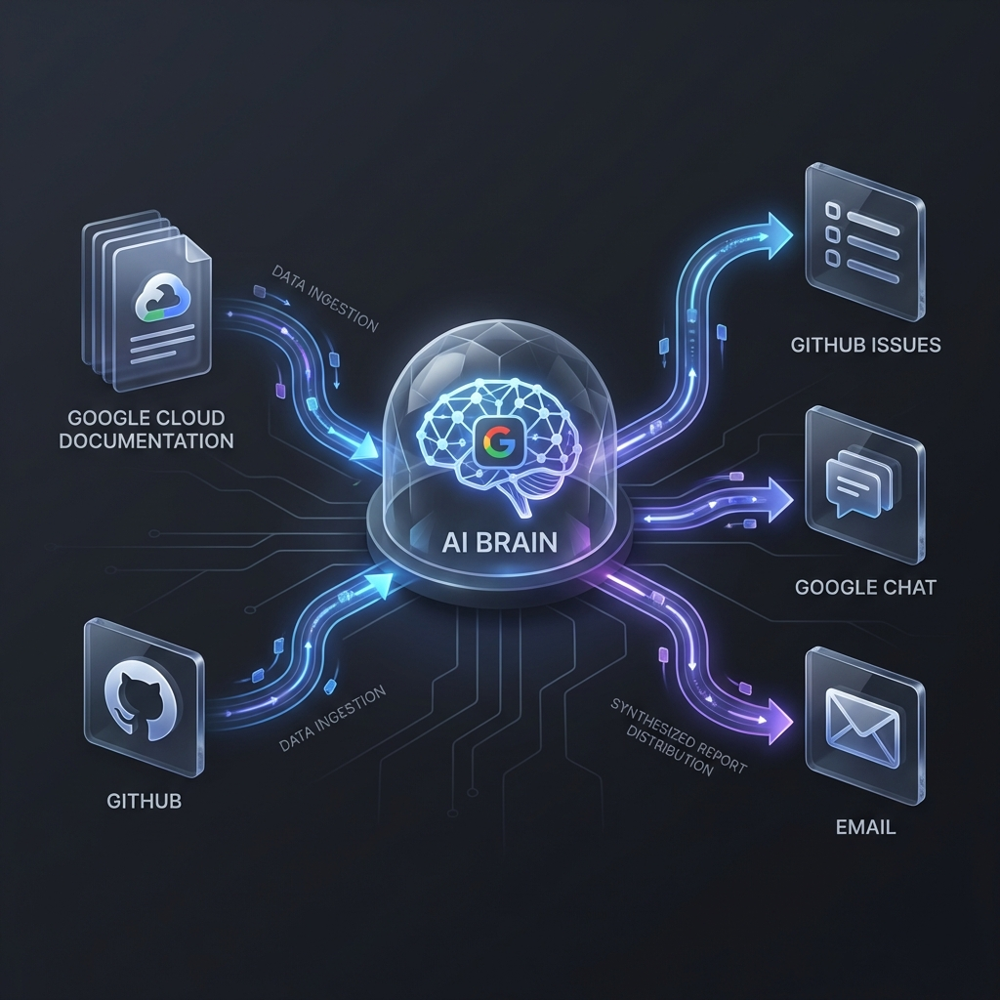
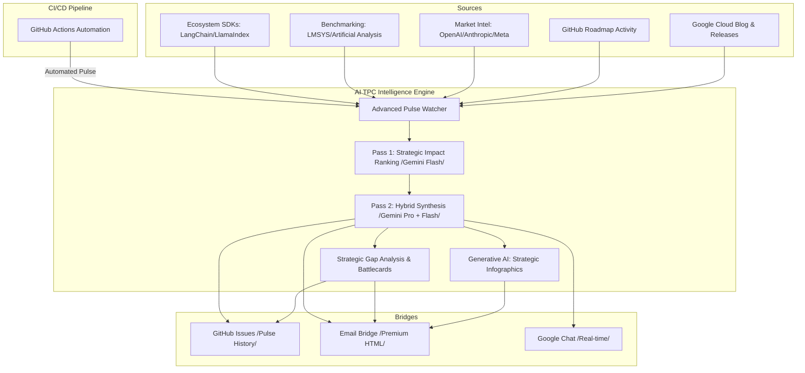

# AI TPC Agent 🚀

Technical Program Consultant (TPC) Agent designed to browse, track, and promote AI knowledge and product roadmaps for field teams.



## Architecture


- **Competitive Intelligence & Response Strategies**: Naturally handles non-Google updates (OpenAI, Anthropic, Meta) by generating standardized **"How Google Responds"** talk tracks focused on Vertex AI's unique pillars.
- **Precision Benchmarking Analysis**: Ingests performance data from **LMSYS**, **Artificial Analysis**, and **LLM-Stats** to pivot conversations from "Lab Speed" to "Production Quality."
- **Strategic Impact Ranking**: Uses AI to score updates (1-100) based on field relevance, ensuring "Mission Critical" launches (like Gemini 3.1) are never buried by SDK noise.
- **Strategic Battlecards & Gap Analysis**: Automatically compares Google's roadmap against competitors to identify feature gaps and "First-Mover" advantages.
- **Automated Pulse Infographics**: Generates high-signal visual dashboards of the last 24-48 hours of AI roadmap shifts.
- **Global Ecosystem Watcher**: Tracks the entire AI landscape including LangChain, LlamaIndex, Pinecone, and SiliconAngle enterprise trends.
- **Enterprise Hardening**: Built-in PII scrubbing, exponential backoff, and prompt-injection validation.

## How it Works
The AI TPC Agent follows a structured **Retrieve -> Synthesize -> Promote** lifecycle:

### 1. Automated Retrieval (The "Watcher")
The agent's **Watcher** engine wakes up (via GitHub Actions) and uses custom scrapers to scan:
*   **Official Release Notes**: Vertex AI, Gemini Enterprise, and Generative AI.
*   **Market Intelligence**: Newsrooms from OpenAI, Anthropic, Meta, and Microsoft.
*   **Precision Benchmarks**: Lmsys Arena, Artificial Analysis, and SemiAnalysis economics.
*   **Developer Ecosystem**: Source code and blogs from LangChain, LlamaIndex, Pinecone, and Google ADK.
*   **Enterprise Trends**: SiliconAngle and High-signal industry analysis.

### 2. AI Synthesis (The "Brain")
Once retrieval is complete, the raw data is passed through a multi-pass synthesis engine:
*   **Intelligent Ranking**: Use **Gemini 2.5 Flash** to analyze all incoming signals and assign an **Impact Score (1-100)**.
*   **Competitive Pulse & Google Responds**: When a non-Google update is detected, the engine generates a **"How Google Responds"** strategy, pivoting the conversation to Vertex AI's managed reliability, 2M+ context window, and TPU efficiency.
*   **Hybrid Deep Extraction**: Uses **Gemini 2.5 Pro** for executive summaries and **Gemini 2.5 Flash** for 3-bullet talk tracks (Key Feature, Customer Value, Sales Play).
*   **Strategic Gap Analysis**: Automatically identifies gaps between Google and competitors to create field-ready battlecards.
*   **Strategic Infographics**: Generates visual dashboards directly from the synthesized pulse data.
*   **Safety First**: Integrates a **Hardened PII Scrubber** and **Prompt Injection Validator**.

### 3. Field Promotion (The "Bridges")
The synthesized intel is pushed through various communication bridges:
*   **Email**: A premium HTML report sent directly to field distribution lists.
*   **GitHub Issues**: A persistent, searchable history of all technical pulses.
*   **Google Chat**: Real-time card-based notifications for immediate visibility.

## Installation
```bash
pip install .
```

## Usage
### Local Report
```bash
tpc-agent report
```

### Google Chat Broadcast
```bash
tpc-agent chat --webhook-url "YOUR_WEBHOOK_URL"
```

### Email Promotion
```bash
# Uses TPC_SENDER_EMAIL and TPC_SENDER_PASSWORD env vars
tpc-agent email "ai-tpc-agent@google.com"
```
### GitHub Issues Broadcast
```bash
# Uses GITHUB_TOKEN and GITHUB_REPOSITORY env vars
tpc-agent github
```

## Sample Terminal Output
```text
🚀 AI TPC AGENT: FIELD PROMOTION REPORT (Last 2 Days)

🌉 ROADMAP BRIDGE: FIELD TALK TRACKS
╭─────────────────────────────────────────────── [OPENAI-NEWS] ──────────────────────────────────────────────╮
│ Feature: o1-preview and o1-mini reasoning models                                                           │
│ Field Impact: COMPETITIVE WATCH: Major update in rival reasoning models.                                    │
│ **Google Response:** Highlight Gemini 1.5 Pro's 2M context window and deep Workspace integration.          │
│ Action: Open Documentation                                                                                 │
╰────────────────────────────────────────────────────────────────────────────────────────────────────────────╯
╭───────────────────────────────────────── [ARTIFICIAL-ANALYSIS] ────────────────────────────────────────────╮
│ Feature: New Benchmark: LLM Throughput vs Quality                                                          │
│ Field Impact: BENCHMARK SHIFT: New performance data detected.                                              │
│ **Google Response:** Pivot from "Raw Speed" to "Production Quality" and Enterprise SLOs.                   │
│ Action: Open Documentation                                                                                 │
╰────────────────────────────────────────────────────────────────────────────────────────────────────────────╯
╭────────────────────────────────────────────── [GOOGLE-ADK] ────────────────────────────────────────────────╮
│ Feature: v1.24.0 Release                                                                                   │
│ Field Impact: DEV EXPERIENCE: ADK Update. Promotes standardized agent building. Essential for              │
│ 'Agent-First' architecture talks.                                                                          │
│ Action: Open Documentation                                                                                 │
╰────────────────────────────────────────────────────────────────────────────────────────────────────────────╯

💡 AI KNOWLEDGE & MARKET TRENDS
### Google Cloud AI Blog: Sovereign AI in 2026
Source: Google Cloud AI Blog - Market Trends & Innovations
Actionable Insight: New regulatory trends in EMEA are driving demand for local-residency AI models...
[🔗 Read Full Update]

---
```

## Scheduling (Field Pulse)
The repository includes a GitHub Action (`.github/workflows/pulse.yml`) to automatically process updates.

**Secure Channel Options:**
1. **GitHub Issues (Default)**: Reports are posted as issues in the current repo. Zero-config (uses `GITHUB_TOKEN`).
2. **Google Chat**: Add `GCHAT_WEBHOOK_URL` to GitHub Secrets.
3. **Email**: Add `TPC_SENDER_EMAIL` and `TPC_SENDER_PASSWORD` (App Password) to GitHub Secrets.

## Alternative: Markdown Persistence
If communication channels are restricted, you can run the agent to append to a local log:
```bash
tpc-agent report >> FIELD_PILOT_LOG.md
```

## Intelligence Targets (Powered by Gemini)
The agent is specifically tuned to recognize and bridge these key themes:
- **Gemini 3.1 Pro & 2.5 Pro**: Highlighting reasoning breakthroughs and long-context capabilities.
- **Benchmarking & Market Intel**: Responding to LMSYS Chatbot Arena and Artificial Analysis rankings.
- **Competitive Battlecards**: Identifying gaps in Google roadmap vs. Anthropic/OpenAI tools.
- **Agent Builder**: Translating low-code simplicity to pro-code extensibility.
- **Performance & Economics**: Using SemiAnalysis trends to sell the value of the TPU-integrated stack.
- **Sovereign AI**: Matching compliance updates to regional deal blockers.
- **Security**: Connecting IAM/Encryption shifts to enterprise governance themes.

---

## 🗺️ Future Growth
See the [**ROADMAP.md**](ROADMAP.md) for planned features, RAG integration, and internal data ingestion milestones.
